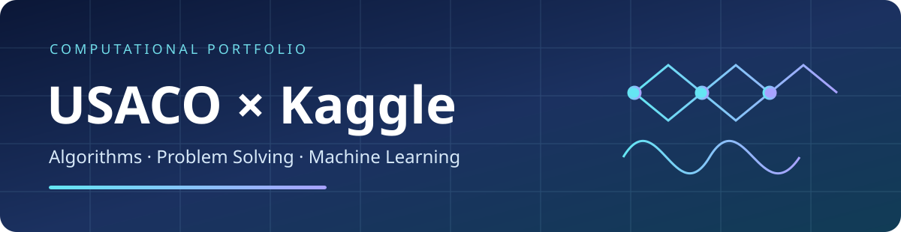

<div align="center">



# USACO × Kaggle

**Algorithms · Competitive Programming · Machine Learning**

[](usaco/) [](kaggle/) [](usaco/README.md) [](kaggle/)

[**USACO Guide**](#-usaco-how-to-get-a-triple-perfect) · [**Kaggle Notebooks**](#-kaggle-original-code-notebooks) · [**Getting Started**](#-getting-started) · [**Repository Layout**](#-repository-layout)

</div>

---

## Explore two technical tracks

| Track | Explore | Source |
|:--|:--|:--|
| **USACO — algorithms** | Bronze, Silver, and Gold solutions, detailed write-ups, complexity analysis, sample tests and stress-test utilities | [Full study guide](usaco/README.md) |
| **Kaggle — applied ML** | Eleven unmodified `.ipynb` files, with their source filenames and notebook contents preserved | [Explore Kaggle overview](kaggle/README.md) |

## 🎯 USACO: How to Get a Triple Perfect

**How to Get a Triple Perfect on USACO** is the educational theme of the [USACO guide](usaco/README.md), not a claim that the repository owner personally earned a triple perfect. The guide uses the **2026 Second Contest** as a worked example of the progression from Bronze through Gold. "Triple perfect" is informal terminology, not an official USACO title.

### A progression through three divisions

| Division | Problems | Core techniques | Read |
|:--|:--:|:--|:--|
| **Bronze** | 3 | XOR invariants, bitmask enumeration, greedy reasoning | [Bronze solutions](usaco/bronze/) |
| **Silver** | 3 | Amortized analysis, cyclic reasoning, two pointers and deques | [Silver solutions](usaco/silver/) |
| **Gold** | 3 | Binary search, graph algorithms, functional graphs | [Gold solutions](usaco/gold/) |

### A practical problem-solving roadmap

1. **Master fundamentals.** Sorting, prefix sums, BFS/DFS, binary search, and bitmasks.
2. **Practice under time limits.** Solve first, then study the reasoning and official analyses.
3. **Stress-test implementations.** Compare optimized solutions against brute force on generated small inputs.
4. **Study edge cases.** Pay attention to integer overflow, circular indexing, and boundary conditions.
5. **Review missed insights.** Record the idea, proof, complexity, and failure modes for each problem.

[**Explore all nine problems, explanations, and C++ solutions →**](usaco/README.md)

> **Competition integrity:** These solutions are for studying before or after contests. Follow USACO's current rules during competitions. The source guide describes testing of its solutions; this combined package was not independently re-tested.

## 🧬 Kaggle: Original Code Notebooks

The notebooks below are **byte-for-byte copies of the original notebook files provided in this conversation**. Code, markdown, outputs, metadata, and filenames were not modified. These are code artifacts, not proof of competition submissions, rankings, or awards.

| Project | Technical focus | Original notebook |
|:--|:--|:--|
| **Stanford RNA 3D Folding** | RNA structure modeling | [Open notebook](kaggle/stanford-rna-3d-folding/stanford-rna-3d-folding-part-2-protenix-tbm.ipynb) |
| **Biohub Cell Tracking** | Cell tracking, geometric fusion, nearest-neighbor baseline, metric experiments, and inference variants | [Browse all eight notebooks](kaggle/biohub-cell-tracking/README.md) |
| **Kaggriculture** | Agricultural machine-learning experiments | [Open notebook](kaggle/kaggriculture/84-84-base-public-holdout-v14-clone-preemption.ipynb) |
| **Pokémon TCG AI Battle Challenge** | Gameplay simulation and matchup analysis | [Open notebook](kaggle/pokemon-tcg-ai/simple-baseline-matchup-tests.ipynb) |

**Biohub notebook collection:** The Biohub folder includes the previously packaged `biohub-geometric-fusion.ipynb` plus seven additional, separately uploaded notebooks. All are preserved under their original filenames.

**Reproducibility note:** Kaggle datasets, packages, accelerators, or external assets may be required. The notebooks were not executed or independently validated when this repository was assembled.

## 🚀 Getting started

**Run a C++17 example:**

```bash
git clone https://github.com/aaryansamanta/usaco-kaggle.git
cd usaco-kaggle

g++ -O2 -std=c++17 usaco/bronze/2-moo-hunt/solution.cpp -o moo
./moo < usaco/bronze/2-moo-hunt/samples/1.in
```

**Explore a Kaggle notebook:** Open an original `.ipynb` in Jupyter or Kaggle, review its dependencies and data paths, then configure the required environment before running it.

## 🗂️ Repository layout

```text
usaco-kaggle/
├── README.md
├── assets/
│   └── banner.svg
├── usaco/
│   ├── README.md             # Detailed triple-perfect study guide
│   ├── bronze/               # Three worked problems
│   ├── silver/               # Three worked problems
│   ├── gold/                 # Three worked problems
│   ├── tools/                # Sample and stress-test utilities
│   └── LICENSE
└── kaggle/
    ├── README.md             # Kaggle overview and notebook index
    ├── stanford-rna-3d-folding/
    ├── biohub-cell-tracking/
    ├── kaggriculture/
    └── pokemon-tcg-ai/
```

## 📖 Scope, attribution and credits

The USACO section is a worked educational guide based on the provided repository. The Kaggle section contains original supplied notebooks, without code edits or inferred results. Problem statements and official analyses belong to USACO and their respective authors. Competition datasets and third-party code remain subject to their own terms. No medals, certificates, or personal award claims are included.
