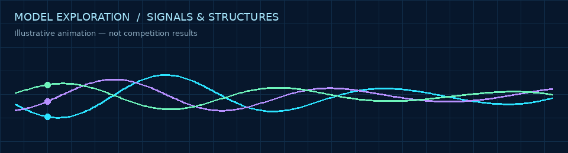

# Kaggle · Machine Learning & Computational Experiments

**Four project collections · 11 original Jupyter notebooks · Python-based experimentation**

   

[**Explore projects**](#-explore-the-projects) · [**Biohub notebooks**](#-biohub-cell-tracking--eight-notebooks) · [**Run notebooks**](#-running-the-notebooks) · [**Repository home**](../README.md)

> **Project portfolio:** Browse source notebooks and the approaches they explore. Visual animations on this page are illustrative, not recorded training runs or leaderboard results.

---

## 🔬 Explore the projects

| Project | Area | Explore |
|:--|:--|:--|
| **Stanford RNA 3D Folding** | RNA structure modeling | [Project guide](stanford-rna-3d-folding/README.md) · [Notebook](stanford-rna-3d-folding/stanford-rna-3d-folding-part-2-protenix-tbm.ipynb) |
| **Biohub Cell Tracking** | Cell tracking, geometric fusion, nearest-neighbor and inference experiments | [All eight notebooks](biohub-cell-tracking/README.md) |
| **Kaggriculture** | Agricultural ML experiments | [Project guide](kaggriculture/README.md) · [Notebook](kaggriculture/84-84-base-public-holdout-v14-clone-preemption.ipynb) |
| **Pokémon TCG AI Battle Challenge** | Matchup tests and gameplay simulation | [Project guide](pokemon-tcg-ai/README.md) · [Notebook](pokemon-tcg-ai/simple-baseline-matchup-tests.ipynb) |

## 🧫 Biohub Cell Tracking — Eight notebooks

The collection contains eight separate notebooks exploring geometric fusion, nearest-neighbor approaches, metric experiments, and inference variants. Notebook contents are preserved as provided.

| Notebook | Link |
|:--|:--|
| Geometric fusion | [biohub-geometric-fusion.ipynb](biohub-cell-tracking/biohub-geometric-fusion.ipynb) |
| X138 experiment | [biohub-x138.ipynb](biohub-cell-tracking/biohub-x138.ipynb) |
| Nearest-neighbor baseline | [cell-tracking-getting-started-w-nearest-neighbor.ipynb](biohub-cell-tracking/cell-tracking-getting-started-w-nearest-neighbor.ipynb) |
| Metric experiment | [improved-metric-hack-last-call.ipynb](biohub-cell-tracking/improved-metric-hack-last-call.ipynb) |
| Inference variant 1 | [sky-biohub-infer1.ipynb](biohub-cell-tracking/sky-biohub-infer1.ipynb) |
| Inference variant 2 | [sky-biohub-infer2.ipynb](biohub-cell-tracking/sky-biohub-infer2.ipynb) |
| Inference variant 3 | [sky-biohub-infer3.ipynb](biohub-cell-tracking/sky-biohub-infer3.ipynb) |
| Inference variant 4 | [sky-biohub-infer4.ipynb](biohub-cell-tracking/sky-biohub-infer4.ipynb) |

## 💻 Running the notebooks

1. Open the relevant `.ipynb` in Kaggle or Jupyter.
2. Review the notebook's imports, datasets, paths, and runtime requirements.
3. Configure the corresponding competition datasets and any required packages or accelerators before running.

> **Source and results note:** These are supplied notebook artifacts, not independently verified competition submissions, leaderboard results, or awards. The notebooks have not been rerun during packaging.

---

[← Back to USACO × Kaggle](../README.md)
